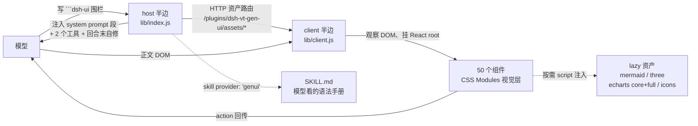

# dsh-genui 能力全景（我们 fork 的对象）

> 对象：`@changfenhuang/dsh-genui@0.14.0`（MIT），已安装在 `~/.dsh/profiles/desktop`。
> 本文回答一个问题：**它到底做了什么**。深到字段级的规格见 [`recon/schema.md`](./recon/schema.md)，
> 渲染层与视觉诊断见 [`recon/visual.md`](./recon/visual.md)，工程契约见 [`recon/scaffold.md`](./recon/scaffold.md)。
>
> 结论先行：它不是「一套好看的组件库」，而是**一条把模型输出的 JSON 变成可交互界面的完整链路**——
> 教模型写围栏 → 收围栏 → 修容错 → 校验 → 渲染 → 本地交互 → 事件回传 → 状态持久化 → 导出。
> 「丑」只发生在链路末端的表现层；链路的其余部分是我们必须保留的资产。

---

## 1. 一句话定位

| 维度 | 事实 |
| --- | --- |
| 输入 | 模型在正文里写 ` ```dsh-ui ` 围栏，内容是一段 JSON（白名单组件树） |
| 输出 | 真实的 React 组件，内嵌在会话正文里，可点、可填、可拖动、可提交 |
| 兜底 | 插件不在 / JSON 坏了 → 退回普通 Markdown 代码块，绝不破坏会话 |
| 规模 | **50 个白名单组件**、4 条渲染通道、9 种降级情形、33 项资源上限 |
| 工作量 | `src/` 111 个文件 / 约 2.98 万行（含 CSS 2575 行） |

---

## 2. 系统由哪几块组成



| 部件 | 产物 | 职责 |
| --- | --- | --- |
| host 半边 | `lib/index.js`（≈190 KB） | 教模型写围栏、注册 `render_ui` / `validate_dsh_ui`、回合末自修、托管懒加载资产、注册 `genui` 技能 |
| client 半边 | `lib/client.js`（≈780 KB） | 观察会话 DOM、解析围栏、修复容错、挂载 React 组件、本地交互、状态持久化、面板 dock、导出 |
| 懒加载资产 | `lib/assets/*.js` | 重型引擎按需下载：pele 700 KB、three 700 KB、echarts-core 588 KB / full 1.04 MB、icons 969 KB、standalone 1.1 MB |
| 技能 | `SKILL.md` | 48 KB 的模型手册：语法铁律、组件词汇、内容→组件映射、编排范式、6 个完整范例 |
| 构建 | `tsdown.config.ts` | 8 个产物：host、client、standalone、5 个 IIFE 资产；CSS Modules 在构建期内联成 `<style>` |

---

## 3. 四条渲染通道（同一个 spec 词汇，四个入口）

| 通道 | 触发方式 | 落点 | 特点 |
| --- | --- | --- | --- |
| 内联围栏 | 正文里写 ` ```dsh-ui ` | 回答正文中 | 主力通道；**边流边渲染**，组件闭合一个上屏一个 |
| 面板围栏 | spec 带 `panel: true` | 输入框上方的常驻 dock | 原地更新、可拖高度、支持 `append` 追加；`/panel` 斜杠命令可呼唤 |
| 工具卡 | 模型调用 `render_ui(spec)` | 工具调用行 | 适合「自包含卡片」，与围栏同词汇；结果走 `presentationMeta` |
| SVG 围栏 | 正文里写 ` ```svg ` | 回答正文中 | 不经过 spec 解析，直接安全渲染 SVG |

另有两个宿主侧工具：`render_ui`（渲染）与 `validate_dsh_ui`（**发出前**自检 JSON，返回 `status/diagnostic/next/repaired_json`）。

---

## 4. 50 个组件（能力清单，字段见 schema.md）

**布局（7）**：`text` `row` `col` `grid`（bento：`cols` 1–12 + `span` 混排） `card`（eyebrow/tone/accent/flat） `divider`（可带章节 label） `spacer`

**展示（12）**：`hero`（封面大数字 + spark） `stat`（指标 + delta + 微趋势） `badge` `progress`（bar/ring + target 标记线） `avatar` `list`（可绑 filter 本地过滤） `table`（**排序/分组/详情展开/合计/CSV·Markdown 复制/7 种单元格类型**） `keyvalue` `timeline` `steps` `file-tree`（折叠） `breadcrumb`

**媒体与图形（7）**：`image` `audio` `video`（比例自适应） `svg` `icon`（64 内联 + 749 懒加载） `arrow` `blocks`（声明式方块图）

**图表（3）**：`chart`（零依赖 SVG：bars/line/donut，series 分组/堆叠） `echart`（14 种 preset 或原生 option 直通，双档引擎） `plot`（函数绘图 + 参数滑块 + 拖拽平移缩放 + 动画循环）

**交互与表单（12）**：`button` `input`（`action` on blur/Enter、IME 安全） `textarea` `select` `checkbox` `radio` `switch` `slider`（300 ms 尾部防抖） `submit`（**本地判卷** + groups 进度） `quiz`（单选即判、可重做） `link` `copy`（可展开预览）

**高级（10）**：`callout` `diff` `json` `code` `mermaid`（Pele 引擎，支持 Mermaid 12.1 全图型；样例见 [`MERMAID-EXAMPLES.md`](./MERMAID-EXAMPLES.md)） `diagram`（editorial 风格 SVG 架构图，自研布局引擎） `scene3d`（three.js） `tabs` `accordion` `blocks`

---

## 5. 顶层 spec 与布局语义

```jsonc
{
  "title": "卡片横幅",     // 可选，支持行内富文本
  "gap": 16,               // 根列间距，clamp 0–96
  "panel": false,          // true → 进面板 dock
  "append": false,         // 仅配合 panel，追加而非替换
  "items": [ /* 组件树 */ ]
}
```

- **单组件根简写**：整块可以就是一个组件对象，自动包成 `{items:[...]}`。
- **嵌套上限**：深度 8、节点 200（超出尾部截断但照常渲染）。
- **坑**：`grid.cols` 不写默认 1 列；`span` 会被 clamp 到 2–12；`callout` 只有 `error` 没有 `danger`。

---

## 6. 交互与状态（这是它最有价值的一半）

| 机制 | 行为 |
| --- | --- |
| **本地优先** | 排序、过滤、折叠、tab 切换、判卷、参数重绘全部在浏览器内完成，零模型往返 |
| **action 回传** | 组件写 `action:"名字"` → 用户操作 → 回传 `[genui-action] 名字 + 组件数据` 的一条用户消息 → 模型重新出图 |
| **诚实交互** | 没写 `action` 的按钮**渲染为禁用**，不做假按钮；连续手势（滑块）只回传停顿值 |
| **聚合** | `radio.group` / `checkbox.group` / 字段 `id` → 写入块级 `answers` / `multiAnswers` / `fields`，供 `submit` 统一交卷 |
| **本地判卷** | 所有成员都是 radio 且带 `answer` 时，submit 不发请求，就地判分、给解析、锁定、"重新作答" |
| **持久化** | `localStorage` 按「会话 + 位点 + 内容指纹」存答案与输入，LRU 200 块；**内容一改自动换新键** → 干净状态；密码类字段永不落盘 |

---

## 7. 容错体系（三档，体感差别很大）

| 档 | 触发 | 用户看到 |
| --- | --- | --- |
| **救** | 字段名写错（24 组别名）、结构小错（裸数组、缺 type、stat 写成列表…）、JSON 尾逗号/未转义引号 | 正常渲染，可能带一条 `warning=` |
| **丢** | 单个组件缺必填字段、颜色/URL 不合规、白名单外 type | 那个组件**静默消失**，其余照常渲染 |
| **降级** | JSON 两级修复都失败、错误无法定位到节点、渲染出 0 个组件 | 整块退回代码块（+ 红色诊断条） |

外加一层**回合内自修**：回合结束时若仍有围栏不可渲染，host 会在同一回合把节点级诊断 steer 回模型让它重发（默认开，每回合最多 2 次，子代理不触发）。

---

## 8. 外围能力（决定"产品感"的部分）

| 能力 | 内容 |
| --- | --- |
| 会话面板 dock | 常驻输入框上方，`panel:true` 原地更新；`/panel`、`/panel clear`、`/panel <指令>`；高度可拖 120–600 px |
| 模板中心 | 11 类场景模板，本地预览 + 一键插词到输入框 |
| 探索成就 | 12 项本地成就与 toast |
| 成果导出 | 单文件 `.html`（内联样式/字体/引擎，离线可交互）+ `.genui.json` |
| 独立运行时 | `standalone-runtime.js` 1.1 MB，用于导出页在不装插件时渲染 |
| i18n | 中/英词典，跟随宿主语言 |
| 富文本 | 行内公式/代码/加粗/高亮/链接，KaTeX 排版；`copy` 预览、`svg` 围栏 |

---

## 9. 安装、构建与共存

| 项 | 事实 |
| --- | --- |
| 安装方式 | `dsh plugin add @changfenhuang/dsh-genui`（profile 依赖）或 `link:` 本地路径 |
| 产物要求 | `main → lib/index.js`、`./client → lib/client.js`（**client 必须是单文件 CJS**，用 `window.__ModuleLoader__.load({id, factory})` 包裹）、`dsh.bundle.patch`、`dsh.client.platform=web` |
| CSS | CSS Modules 在构建期被 `lightningcss` 转换为字符串 + 注入 `<style data-plugin-css>`，**不进 bundle 的 CSS 通道** |
| 资产 | 由 host 的 `webserver` 服务注册前缀路由 `/plugins/<包名>/assets/*`，client 用 `?rev=` 缓存击穿 |
| **共存风险** | 新旧插件**不能同时启用**：都会注入同一个 system prompt 段、都观察 `dsh-ui` 围栏 DOM、都注册同名工具与技能 → 双渲染 / 工具冲突。切换时必须先禁用 `genui` 这一 row |
| 许可 | MIT。fork 必须保留 `LICENSE` 与 `THIRD_PARTY_NOTICES.md`（pele / three / echarts / katex 等） |

---

## 10. "保留什么 / 重做什么" 的判断（本项目的核心结论）

| 层 | 决定 | 理由 |
| --- | --- | --- |
| 围栏标签、50 个 type 名、必填字段名、别名表、上限数量级、安全过滤、JSON 两级修复、坏组件/坏围栏分界 | **原样保留** | 这些是模型侧契约：技能文件、系统提示、历史会话都按它写。改了等于全量失效 |
| 解析 / 修复 / 校验 / 状态 / 交互 / 面板 / 导出 / 资产路由 | **原样保留** | 与视觉无关的成熟工程，重写只增加风险 |
| 颜色 / 字号 / 间距 / 圆角 / 阴影 / 动画 | **重做** | 现状是 `--dsl-g-*` 自建 token 层 + 2575 行 CSS，视觉结论见 `recon/visual.md` |
| 组件内部结构与类名 | **视诊断结果重做** | 只改 token 够不够，取决于间距/层级问题是否来自 TSX 结构 |
| 图表绘制（`chart` / `plot`）、表格视觉、图标来源 | **可换实现** | 只要保留字段语义 |
| 面板形态、诊断条文案、i18n | **可调整** | 不影响契约 |

---

## 11. 本仓库现状（初始化已完成）

| 项 | 状态 |
| --- | --- |
| fork 源码 | `src/`（111 文件）已迁入，包名/路由/全局符号已改为 `dsh-vt-gen-ui` |
| 依赖 | `pnpm install` 通过（pnpm 10.33.2 / node 22.22.0），68 个 devDeps |
| 构建 | `npx tsdown` 通过 → `lib/index.js` + `lib/client.js` + `lib/assets/*`（8 个产物） |
| 类型检查 | `npx tsc -p tsconfig.json` 通过 → `lib/types/**` |
| 清单 | `package.json`（`dsh.bundle` / `dsh.client`）+ `cordis.patch.yml`（insert id `dsh-vt-gen-ui`） |
| 装机 | **已切换**（2026-11-01）：旧插件 `@changfenhuang/dsh-genui` 已禁用 → 新插件 `dsh-vt-gen-ui@0.1.0` 已 link 安装（`application: applied`）。三条验证：`render_ui`/`validate_dsh_ui` 工具在位、`genui` 技能回到技能目录、client 端 `genui-panel` 已占位 `conversation.input.dock`、`/plugins/dsh-vt-gen-ui/assets/pele.js` 返回 200 |
| 回滚 | `plugin_manager set_bundle dsh-vt-gen-ui enabled=false` → 再 `set_bundle @changfenhuang/dsh-genui enabled=true`（顺反了会因重复注册抛错） |
