# Mermaid 图型样例库

> 引擎：Pele 1.13（Mermaid 12.1 语法，MIT）。本文每条样例都在本地用`renderMermaid()` 实跑过，能出图才写进来；新增图型时请照这个标准补。

用法：在 `dsh-ui` 里放一个 `mermaid` 节点，`code` 就是下面的源码。

```json
{"type":"mermaid","code":"graph TD\\n  A-->B"}
```

配色不由图自己决定：`.mermaid` 把宿主 token 映射成 `--pele-*`（见 [DESIGN.md §3.1](../DESIGN.md)），切主题不需重渲染。标签内还支持 `$$…$$`（KaTeX）与 `@{ icon: "fa:fa-xxx" }`（插件图标集）。

## 语法坑速查

| 图型 | 规则 |
| --- | --- |
| `eventmodeling` | 一帧一条实体；实体只有 `ui` / `command` / `event` / `readmodel` |
| `swimlane-beta` | 用 `subgraph` 当泳道，没有 `lane` 关键字 |
| `usecase-beta` | `user(用户)` / `usecase(…)` 圆括号声明 |
| `radar-beta` | 曲线是 `curve 名{1, 5}`（花括号） |
| `xychart-beta` | `title` 要引号；坐标轴刻度用 ASCII |
| 标识符 | `requirement` / `component` / `actor` / 类名/实体名必须 ASCII，中文只能进引号或标签 |
| 分类色 | `--pele-series-*` 已接 `--dsl-g-data-*`（单色阶）；时间线等图的内部调色板不参与映射 |

## 流程与结构

### flowchart

缺 `graph TD` 头的裸箭头片段会被自动补上声明，但显式写出来更稳。

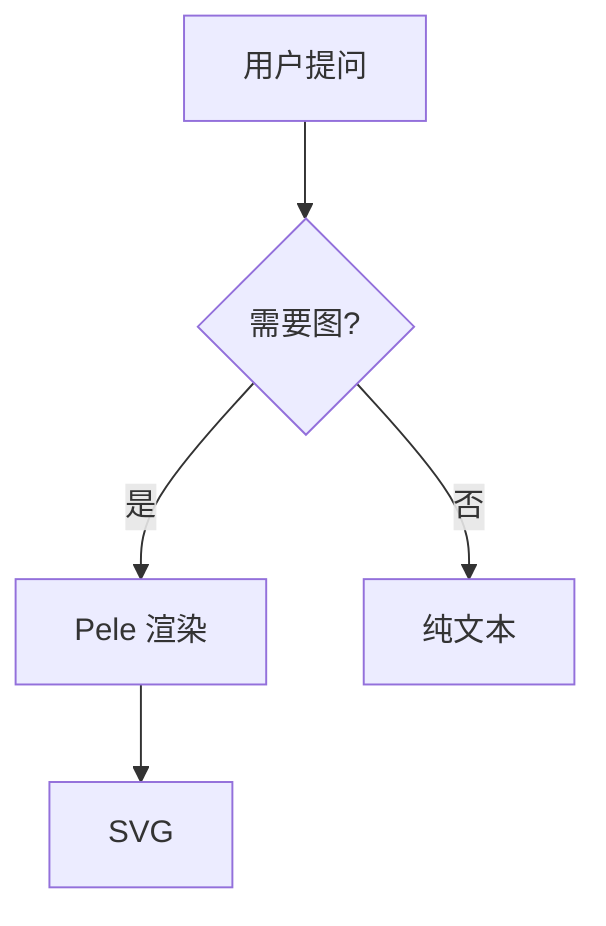

### swimlane

泳道用 `subgraph` 表达，没有 `lane` 关键字；方向写在首行（`swimlane-beta TD`）。

```mermaid
swimlane-beta TD
  subgraph 用户
    A[发起请求]
  end
  subgraph 服务
    B[校验]
  end
  subgraph 存储
    C[落库]
  end
  A --> B
  B --> C
```

### sequence

`participant X as 中文` 可给参与者起中文名；消息文本直接写中文。

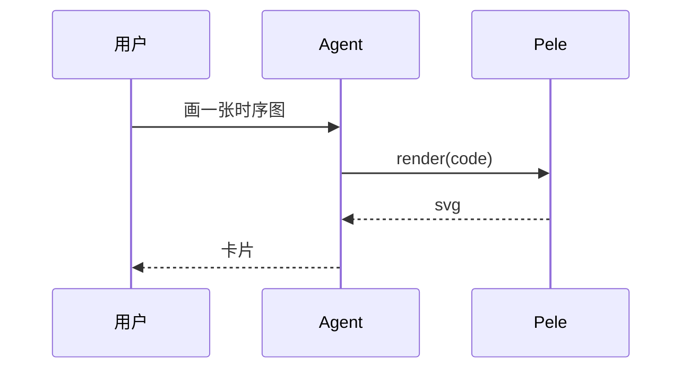

### class

类名与成员用 ASCII，成员里的中文注释需要引号。

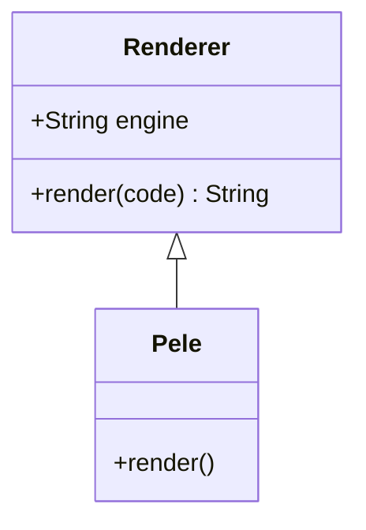

### state

状态名可以用中文；转移标签写在 `:` 之后。

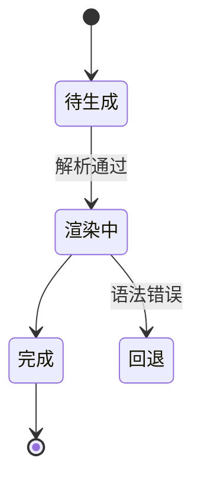

### er

实体名与关系标签都建议 ASCII + 引号，字段块内是 `类型 名称`。

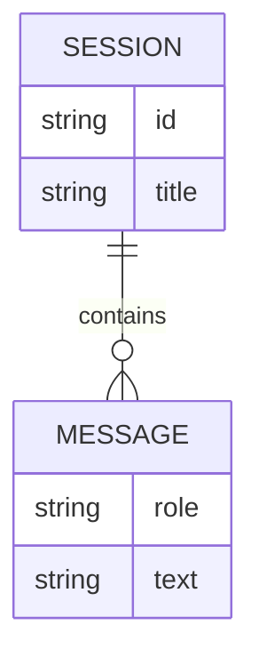

### block

`columns` 固定列数；`space` 占位空块。

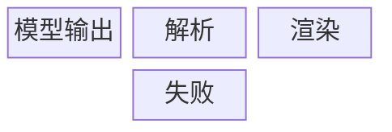

### architecture

内置符号名（`server` / `database` / `cloud` / `disk`）决定节点图标；`in api` 表示属于某个 group。

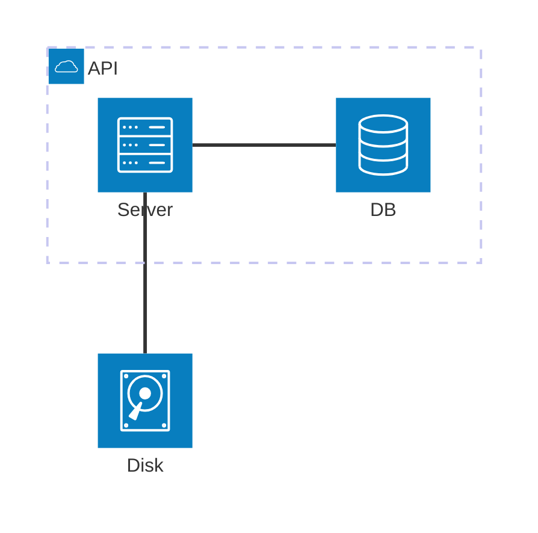

### c4

标题与所有标签都要引号；`Rel(a, b, \"标签\")` 三参数。

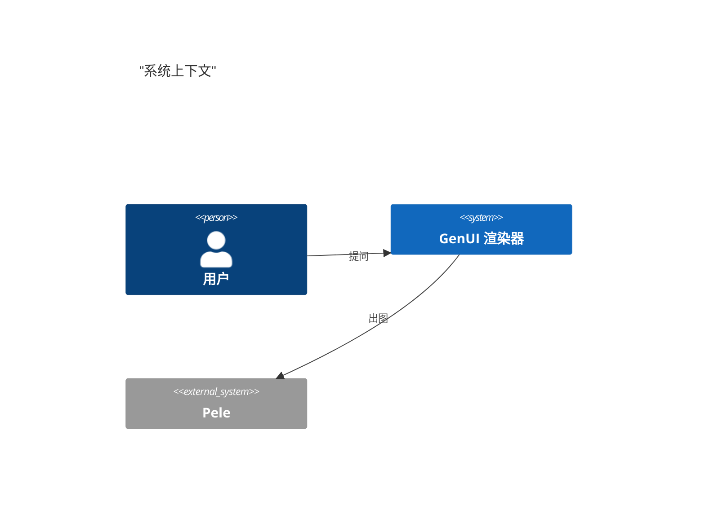

### usecase

演员与用例用圆括号声明（`user(用户)`），不是 `actor` / `usecase` 关键字。

```mermaid
usecase-beta
  user(用户)
  ask(提问)
  user --> ask
```

## 数据与图表

### pie

`\"标签\" : 数值`，标签必须引号。

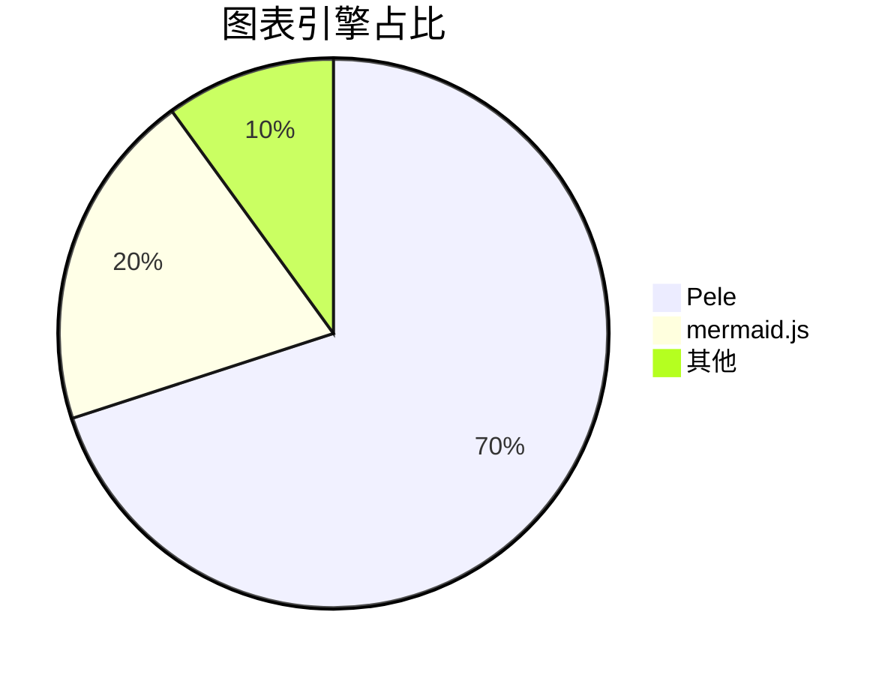

### xychart

`title` 要引号；坐标轴刻度标签用 ASCII 更稳；`bar` 与 `line` 可同时出现。

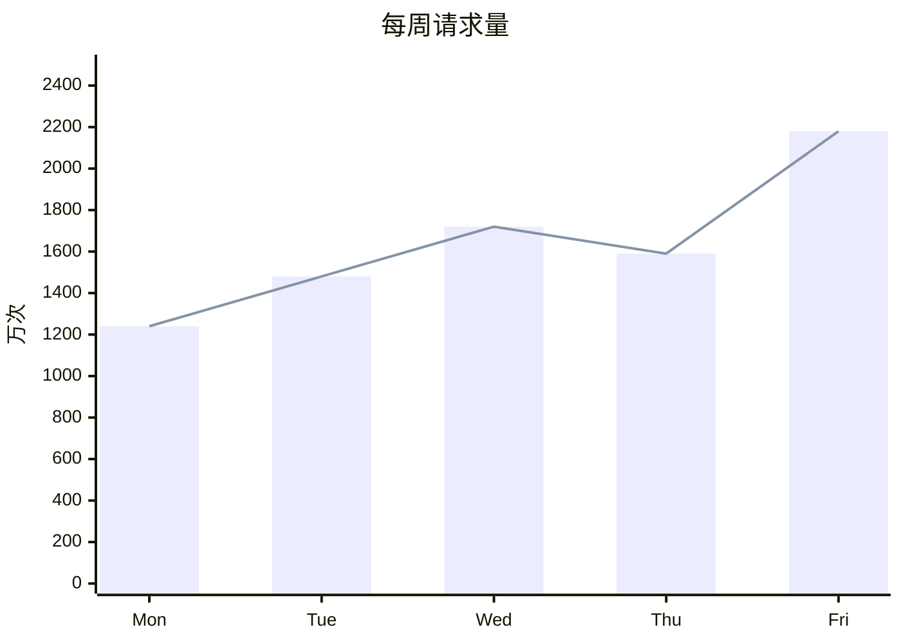

### quadrant

四个象限用 `quadrant-1..4` 命名；点位是 `名称: [x, y]`，取值 0–1。

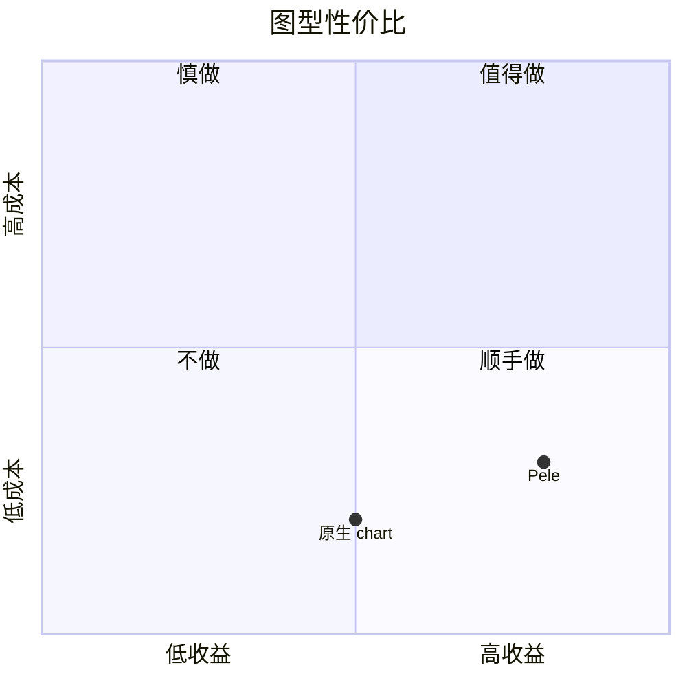

### sankey

每行 `源,目标,数值`，支持中文节点名。

```mermaid
sankey-beta
  模型输出,解析,120
  模型输出,失败,8
  解析,渲染,104
  解析,回退,16
```

### radar

轴用 `axis a[\"名\"], b[\"名\"]`；曲线是 `curve 名{1, 5}`（花括号，不是方括号）。

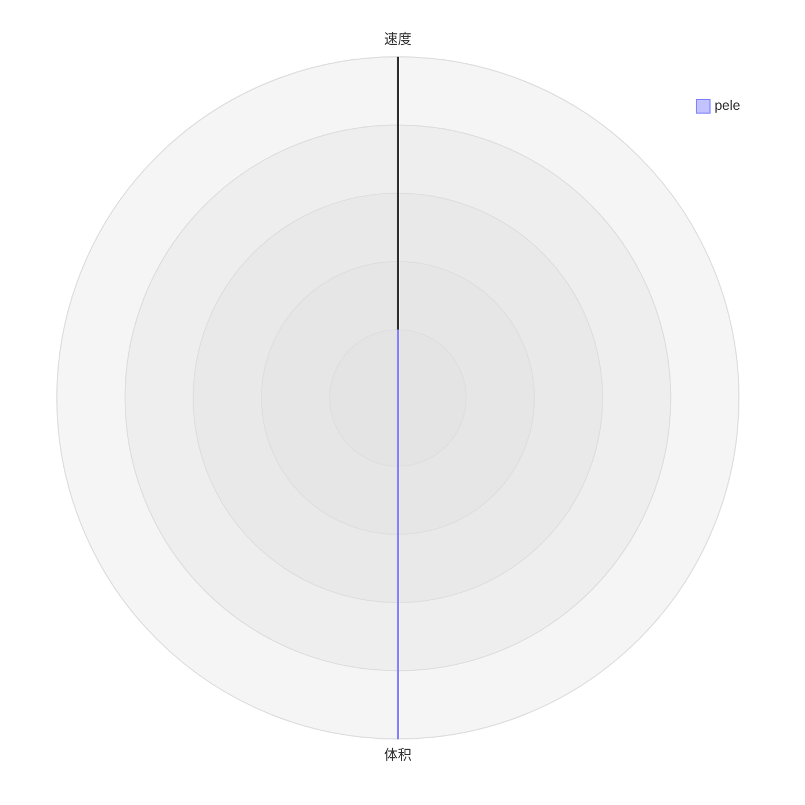

### treemap

缩进表达层级，叶子是 `\"名称\": 数值`。

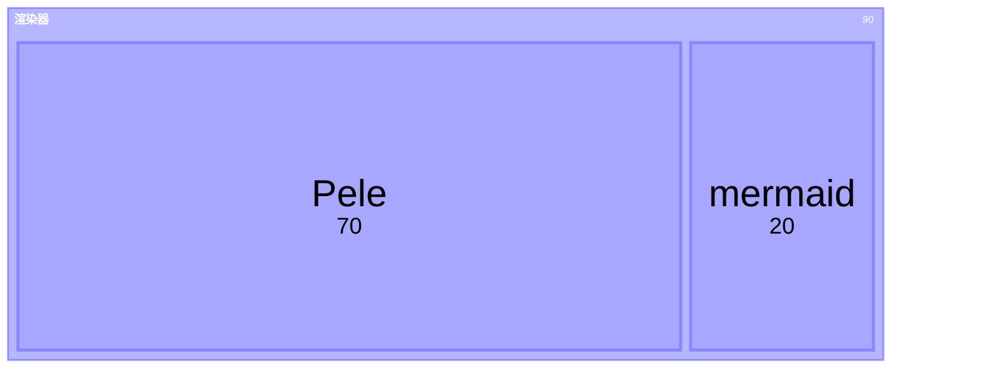

### gantt

`dateFormat` 之后用 `任务 :状态, id, 起始, 时长`；`after a3` 表示串行。

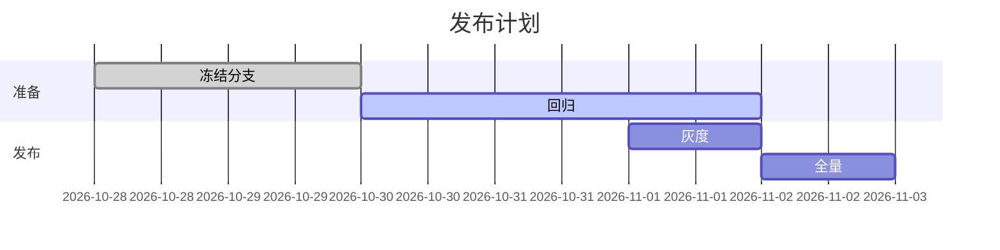

### gitGraph

`commit id: \"…\"`、`branch`、`checkout`、`merge` 与 Mermaid 一致。

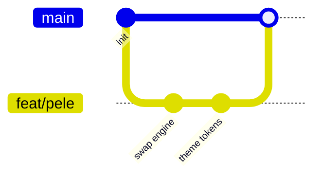

### packet

`起-止: \"字段名\"`，位区间必须连续。

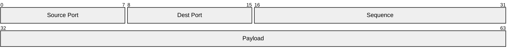

### railroad

EBNF 方言（`railroad-ebnf-beta`）：`a = \"x\", b;`。

```mermaid
railroad-ebnf-beta
  a = "x", b;
  b = "y";
```

## 规划与思考

### mindmap

缩进即层级；根用 `root((名称))`。

```mermaid
mindmap
  root((GenUI))
    图表
      chart
      echart
    图型
      flowchart
      timeline
    加载
      网点波浪
```

### kanban

列名顶格，卡片写 `[文本]` 并缩进到列下。

```mermaid
kanban
  待办
    [设计 token]
    [接 resolver]
  进行中
    [换引擎]
  已完成
    [网点波浪]
```

### timeline

`时间 : 事件`；`title` 可选。

```mermaid
timeline
  title 发布节奏
  10-28 : 冻结分支
  10-30 : 回归通过
  11-01 : 灰度 10%
  11-02 : 全量
```

### journey

`任务: 分数: 角色`，分数 1–5 决定情绪点。

```mermaid
journey
  title 生成一次回答
  section 输入
    提问: 5: 用户
  section 渲染
    流式: 3: 用户
    落定: 5: 用户
```

### requirement

`requirement` / `element` 名必须 ASCII；`text:` 后面可写英文短语。

```mermaid
requirementDiagram
  requirement render {
    id: 1
    text: sync svg
    risk: low
    verifymethod: test
  }
  element Pele {
    type: engine
  }
  Pele - satisfies -> render
```

### ishikawa

缩进表达「问题 → 类别 → 原因」。

```mermaid
ishikawa
  质量问题
    渲染
      字体
      颜色
    解析
      语法
      版本
```

### wardley

`component 名 [可见度, 成熟度]`，坐标 0–1；`A -> B` 表示依赖。

```mermaid
wardley-beta
  title "地图"
  component model [0.6, 0.7]
  component render [0.7, 0.5]
  model -> render
```

### cynefin

四个域各一行，文本要引号。

```mermaid
cynefin-beta
  clear "明确问题"
  complicated "复杂问题"
  complex "错综问题"
  chaotic "混乱问题"
```

### eventmodeling

一帧一条实体，实体类型只有 `ui` / `command` / `event` / `readmodel`；多实体拆多帧。

```mermaid
eventmodeling
  tf 01
    ui Form
  tf 02
    command Submit
  tf 03
    event Submitted
  tf 04
    readmodel List
```

### venn

`set A: 12`、`union A, B: 4`。

```mermaid
venn-beta
  set A: 12
  set B: 9
  union A, B: 4
```

### treeview

缩进表达目录层级；`treeView-beta` 也支持内置文件/目录符号。

```mermaid
treeView-beta
  src/
    client/
      blocks.tsx
    plugin/
      index.ts
```

### info

渲染 Pele 自身的诊断信息面板，主要用于排查。

```mermaid
info
  showInfo
```
