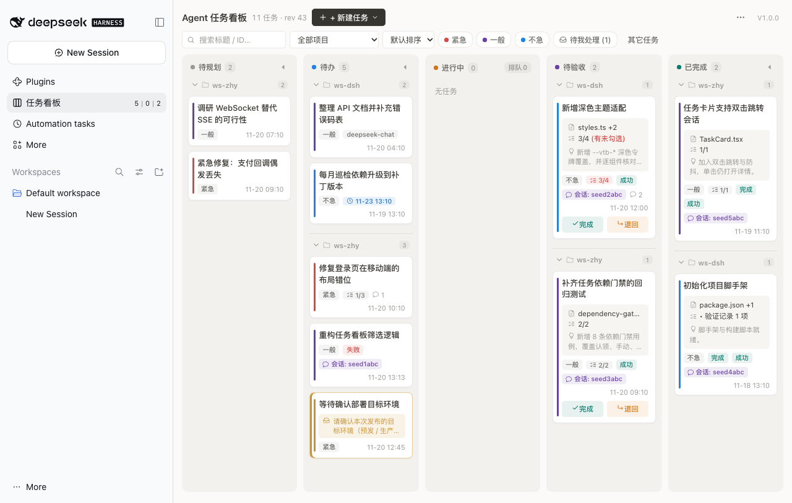
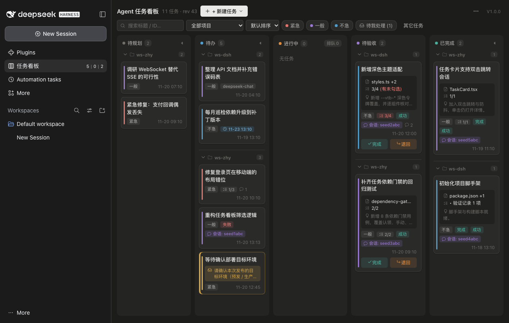

# VT 任务看板（dsh-vt-taskboard）

DeepSeek Harness 的任务看板：**人建卡 → Agent 认领执行 → 人验收**。任务挂项目、可指定模型与 preset、
支持手动与定时执行，全流程双向协作。

本包是 [`dsh-taskboard`](https://github.com/cloader/dsh-taskboard) 0.10.0 的 fork：**功能对齐上游，
视觉层重做**——暖白纸面、白色卡片、发丝描边、线性图标，深浅两套主题。设计约定见 [DESIGN.md](./DESIGN.md)。

## 界面

<p align="center">
  
</p>
<p align="center">
  
</p>

## 它做了什么

- **闭环协作**：建卡 → agent 认领执行 → 结构化执行报告 → 人验收（完成 / 退回附原因）
- **五列看板**：待规划 / 待办 / 进行中 / 待验收 / 已完成，SSE 实时刷新、项目分组折叠、筛选排序持久化
- **10 个 `taskboard_*` agent 工具** + 代码级协议闸：agent 永远移不到「已完成」，任务被持有不可抢
- **执行**：手动、一次性定时或 cron 定期执行（host 侧调度，浏览器关了照跑）
- **Git Worktree 隔离**：每次执行独立 worktree + 任务分支，验收时一键合并；多仓库工作区整区镜像
- **验收效率**：DoD 验收清单（附证据）、执行报告分栏、看板内 diff 查看器
- **界面语言**：简体中文 / English / Русский，默认跟随 DSH
- **外部任务同步**：禅道、TAPD 的缺陷 / 需求 / 任务导入（可选）

## 视觉重做（与上游的差别）

| 维度 | 上游 | 本包 |
| --- | --- | --- |
| 色彩 | 跟随宿主令牌 + 硬编码状态色 | 自建 `--vtb-*` 纸张令牌，深色只覆盖令牌 |
| 图标 | emoji（🛠 ⚙ ⬆ ⬇ ＋ ⚡ …） | 线性图标集（Lucide 几何） |
| 工具栏 | 11 个控件平铺一行 | 身份行 + 筛选行，低频操作收进「更多」 |
| 卡片 | 灰底 + 边框 | 白卡 + 发丝描边 + hover 抬升，交付概览压缩 |
| 弹窗 | 16px 圆角、重阴影 | 14px 圆角、分层阴影、浅底操作区 |

## 安装

```bash
# 从本仓库本地目录安装（开发/自用）
dsh plugin --profile web add link:/absolute/path/to/plugins/vt-taskboard

# 或从 npm 安装（发布后）
dsh plugin --profile web add dsh-vt-taskboard
```

安装后**重启 `dsh web` 并刷新页面**：侧栏出现「任务看板」入口即成功。
卸载：`dsh plugin --profile web remove dsh-vt-taskboard`（台账数据保留，见下）。

> 官方的 `@deepseek-ai/dsh-*` 包只写进 profile 的 `bundles` 列表，不要 `plugin add` 进 dependencies。

## 支持的 DSH 版本

`engines.dsh`: `>=0.2.1-rc.5 <0.3.0`。超出范围时安装会被拒绝，或面板无法注册（依赖 DSH 的
官方 slot 面板服务）。上游要求的 Node ≥ 24.9 在本包放宽为 `^22.19.0 || >=24.0.0`。

## 数据与隐私

全部数据存本机，不外发，不需要 Token / API Key：

| 路径 | 内容 |
| --- | --- |
| `$DSH_HOME/dsh-vt-taskboard.json` | 任务台账（任务 / 执行 / 评论） |
| `$DSH_HOME/dsh-vt-taskboard-templates.json` | 任务模板 |
| `$DSH_HOME/dsh-vt-taskboard-assets/` | 图片附件 |
| `$DSH_HOME/dsh-vt-taskboard-storage.json` | 自定义数据目录的位置引导文件 |

> 与上游的数据文件名不同（上游是 `dsh-taskboard*.json`），因此本包不会读取也不会覆盖上游台账。
> 如需迁移，停掉 DSH 后把上游三个数据项改名为上面的名字即可。

## 安全边界

- 插件代码运行在用户进程内，**没有沙箱**。
- Worktree 隔离是协作约定，不是安全边界：执行会话拥有完整工具权限，不适用于运行不可信代码。
- 验收权只属于人：agent 把任务移到「已完成」的调用会被代码级协议闸拒绝。

## 开发

```bash
npm install
npm run build        # host + client 两半产物写到 lib/（lib/ 必须入库）
npm run typecheck
npm test             # vitest，717 条
```

| 目录 | 作用 |
| --- | --- |
| `src/host/` | 宿主半边：工具、台账、路由、调度、git 隔离 |
| `src/shared/` | 双端共享的协议与类型 |
| `src/client/board/` | 看板 UI 组件 |
| `src/client/styles.ts` | 视觉令牌与全部样式（改视觉从这里开始） |
| `src/client/icons.tsx` | 线性图标集 |

视觉改动请先读 [DESIGN.md](./DESIGN.md)；本地验收可用隔离实例
（`DSH_HOME=<临时目录> dsh --profile web --port <端口>`）截图对照。

## 许可与致谢

- 上游：`dsh-taskboard` 0.10.0，经作者 [@cloader](https://github.com/cloader) 以 Apache-2.0 发布。
- 本包沿用 **Apache-2.0**，详见 [`LICENSE`](./LICENSE) 与 [`THIRD_PARTY_NOTICES.md`](./THIRD_PARTY_NOTICES.md)。
- 图标几何来自 [Lucide](https://lucide.dev)（ISC）。
- 本包与上游注册同名 agent 工具与提示段，**不要同时启用**。
