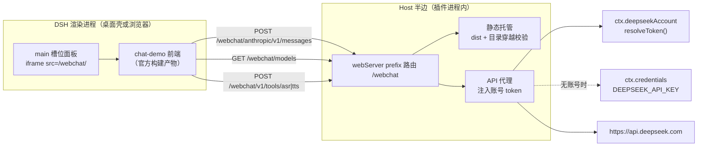

# 01 · 用官方 chat-demo 重做「网页对话」

> 调研时间：2026-11-21
> 结论：已实现并验证。`vt-web-chat` 从「桌面端内嵌浏览器打开 chat.deepseek.com」改成
> 「插件自己托管官方 chat-demo 前端 + 宿主代理 DeepSeek API」，版本 `2.0.0`。
> 实现过程中新增了一项需求：会话保留策略（默认 30 天，可在设置里改），见 §10。

## 1. 现状与故障归因

`vt-web-chat` 1.2.1 用桌面壳的 guest 租约桥（Electron `<webview>`）打开 `chat.deepseek.com`。
三个问题都由「我们不是那个站点的宿主」直接导致：

| 现象 | 根因 | 能否在现方案里修 |
|---|---|---|
| 进入后提示使用环境异常 | 站点检测到 Electron 运行环境 | 只能替用户勾「不再提示」，改 UA 属于伪装，不做 |
| 经常要重新登录 | guest 分区是内存级（`dsh-sidebar-browser-<uuid>` 无 `persist:` 前缀），退出即丢 Cookie | 只有上游 DSH 改成磁盘分区才行，插件层改不动 |
| Web 环境（浏览器）不可用 | 租约桥只在桌面壳里存在 | 不可能 |

也就是说，只要页面还是 `chat.deepseek.com`，这三件事都不在我们的控制范围内。

## 2. 目标

1. 界面与交互是 DeepSeek 网页版那一套，但由我们的插件自己提供，不再依赖站点；
2. 用 DeepSeek API 计费与出结果，**不需要用户填 API Key**，直接用 DSH 里已登录的 DeepSeek 账户；
3. 不再有「使用环境异常」，不再需要反复登录，桌面端与 Web 端行为一致；
4. 与 DSH 自身的会话、系统提示词、工具彻底分开：这是一个「聊天用的 DeepSeek」，不是一个更弱的 agent。

## 3. 三方验证过的事实

| 事实 | 来源 | 对本计划的意义 |
|---|---|---|
| 官方开源前端是 [`deepseek-ai/chat-demo`](https://github.com/deepseek-ai/chat-demo)（MIT），纯静态、无后端，浏览器直连 API | 官方 README | 可以直接托管，不需要我们写后端 |
| 它走 **Anthropic 兼容的 Messages / Files API**，默认 `apiOrigin = https://api.deepseek.com`，由 `createConfig({ apiOrigin })` 注入 `__API_ORIGIN__` | `rspack.config.ts` | 构建时把 `apiOrigin` 指到我们的插件路由即可，不必改前端代码 |
| `output.publicPath: 'auto'`，资源按脚本相对位置加载 | 同上 | 可以挂在 `/webchat/` 这样的前缀下，不需要额外的 base 配置 |
| 官方 API 已开放「全家桶」能力：`deepseek_web_search` / `deepseek_read_url`、文件输入、ASR/TTS、思考 | [官方公告](https://api-docs.deepseek.com/news/news261113) | 网页版的搜索、深度思考、引用、语音都能 1:1 成立 |
| DSH 账号路由的 token 通过 `x-dsh-auth-token` 发往 `inferenceOrigin`（默认 `https://api.deepseek.com`），文件认证同一来源 | `dsh-deepseek-account` README | 宿主可以代发推理与文件请求，浏览器不需要 Key |
| 账号路由的模型目录来自 `GET https://api.deepseek.com/models`，按账号实际可用模型给 | `dsh-llm-deepseek-account` README | 模型不能硬编码，应跟随账号目录 |
| `webServer` 支持 `prefix` 路由 + Fetch `Response` 或 Node `handler`，静态与 POST 都能承载 | `dsh-host-webserver` README | 一个插件路由就能同时做静态托管与 API 代理 |
| DSH 的 `main` + `sidebar.panellist` 槽位可以挂一个整页面板，同源 `iframe` 可用 | `vt-web-chat` 现有实现 + 社区 [`chat-in-dsh`](https://github.com/YinkaiYu/chat-in-dsh) | 不需要桌面壳的 webview 租约，Web 端也成立 |
| `chat-in-dsh`（MIT）已经用这套架构跑通，产物 dist ≈ 4.25 MB、153 个文件 | 其仓库树 | 架构判定有独立证据；也提示「产物要 vendor 进仓库」 |

## 4. 目标架构

请求路径与凭据：

1. 浏览器侧的 `chat-demo` 只认 `/webchat` 这一个 origin，不持有任何密钥；
2. 宿主把 `/webchat/<path>` 拼回 `https://api.deepseek.com/<path>`，带上 `x-dsh-auth-token`；
3. 账号不可用时退回 `DEEPSEEK_API_KEY`（`Authorization: Bearer`），两者都没有就返回明确的 401 文案；
4. 流式响应按字节回灌，不缓冲整段；`files` 的 multipart 用流式转发，避免大文件进内存。

## 5. 关键决策（需要确认）

| 决策 | 选项 | 建议 |
|---|---|---|
| 实现归属 | A 自研 v2 替换 `vt-web-chat` / B 市场收录 `chat-in-dsh` / C 两者并存 | **A**。我们已有「网页对话」入口与用户预期，自研可控文案、i18n、自检与发版节奏；B 只作为架构参照 |
| 构建产物 | A vendor `dist` 提交进仓库 / B 安装时构建 / C 要求用户自己 build | **A**，符合仓库约定 §5「构建产物提交进仓库」，安装即用 |
| 上游同步 | A pin commit + patches + 同步脚本 / B 跟随 main | **A**。上游是官方活跃仓库，patch 面越小越好 |
| 与 DSH 会话的关系 | A 完全独立 / B 支持单向导入 DSH 会话 / C 双向同步 | **A + 可选 B**。双向同步会让两套系统提示词互相污染 |
| 模型 | A 跟随账号目录（`/models`） / B 固定 `deepseek-flash` | **A**，`/models` 本来就代理到账号目录，顺手即可 |
| v1 范围 | 对话/流式/思考/搜索/引用/文件/Markdown+Mermaid+KaTeX/深浅色 | 语音（ASR/TTS）与桌面麦克风桥放 v1.1 |

## 6. 分阶段执行计划

### P0 · 可行性与协议验证（0.5 天，先做，失败即止损）

目的是用最小代码量证明「账号 token 能顶替 API Key 驱动官方前端」，再谈界面。

- [ ] 把官方 `dist` 原样放到 `/webchat` 静态路由，验证：
  - 桌面端 `main` 面板 iframe 能加载并渲染；
  - Web 端（浏览器）同样能加载；
  - 资源、字体、异步 chunk 在 `/webchat/` 前缀下 200。
- [ ] 用一个 30 行的代理验证 `POST /anthropic/v1/messages` 流式成功（账号 token / API Key 各一次）。
- [ ] 验证 `GET /models` 返回账号目录，确认默认模型 id 与 `deepseek-flash` 的关系。
- [ ] 验证 `deepseek_web_search`、`deepseek_read_url`、`thinking` 扩展参数被接受，且响应块能原样回传第二轮。
- [ ] 记录失败点：哪些端点需要额外头（`anthropic-version`、`anthropic-beta: files-api-2025-04-14`）。

**通过标准**：一句话提问能在面板里流式回答，且带思考与搜索引用。
**失败退路**：若账号 token 只允许部分端点，则退回「API Key 优先 + 账号尽力」并在设置页说明。

### P1 · 插件骨架（1 天）

- [ ] 目录调整：`plugins/vt-web-chat/` 下新增 `webview/dist/`（产物）、`patches/`、`scripts/sync-upstream.mjs`。
- [ ] Host 半边重写：`index.js` 只留 `apply`，路由与代理拆到 `src/route.js`（静态）、`src/proxy.js`（转发）、`src/auth.js`（凭据）。
- [ ] 静态托管：MIME 表、`..` 穿越拒绝、`index.html` 现读注入引导脚本（避免升级后引用旧 chunk）。
- [ ] 请求准入：复用 `ctx.get('connection').requestRejection(req)`，桌面 `dsh-app:` 放行（与 `vt-quick-chat` 同一套）。
- [ ] Client 半边重写：`client.js` 从 915 行降到 ≈150 行，只做面板 + iframe + 错误边界 + 空态（凭据缺失时给「去登录」/「去模型设置」）。
- [ ] 保留 `sidebar.panellist` 的 `order: -10`（贴着「新会话」），`main` 的 key 不变，用户升级后入口位置不变。
- [ ] locale：`zh` / `en` 文案改为「由 API 驱动的网页对话」，去掉 webview 相关描述。

**通过标准**：`dsh plugin add` 后重启即用；无凭据时面板给出可操作提示而不是白屏。

### P2 · 前端适配与体验对齐（1–2 天）

- [ ] 构建补丁（保持在个位数、可重放）：
  - `apiOrigin` 指向 `/webchat`；
  - 去掉/隐藏「API Key」设置项与首屏 key gate（用引导脚本塞占位值也可以，改代码更干净）；
  - 品牌位（左上角标识）改成我们的口径，避免用户以为是官网直连；
  - 语言跟随宿主 locale，主题跟随 DSH 深浅色。
- [ ] 首页引导脚本：一次性写入 `locale` / `thinking` 默认值，之后完全交给上游自己的设置。
- [ ] 上传与语音：文件走 `/webchat/anthropic/v1/files`；语音按需补 `/webchat/v1/tools/{asr,tts}`。
- [ ] 桌面麦克风桥：桌面壳只给主框架授权，面板从 `window.top` 取流（`chat-in-dsh` 已验证的路径）。
- [ ] 自检路由 `GET /webchat/api/self-test`：入口页、主 chunk、一次真实 messages 往返。

**通过标准**：在面板里能完成「发问 → 思考 → 搜索引用 → 上传 PDF → 多轮」且第二轮上下文正确。

### P3 · 验证、清理与发布（0.5–1 天）

- [ ] 测试：代理单测（鉴权选择、路径拼接、错误帧）、静态穿越、凭据缺失、`models` 回退。
- [ ] 删除 `webview` 租约相关代码与桌面端耦合，README 重写（含迁移说明）。
- [ ] 版本 `1.2.1 → 2.0.0`（行为与载体都变了，属于破坏性升级）。
- [ ] `pnpm market` → tag `vt-web-chat-v2.0.0` → CI 发布。
- [ ] 迁移说明：旧面板登录的是官网账号，历史在官网；新面板历史是自己的 IndexedDB，
      需要旧历史时用官网「设置 → 数据管理 → 导出所有历史对话」再在新面板导入。

## 7. 风险与对策

| 风险 | 影响 | 对策 |
|---|---|---|
| 账号 token 覆盖的端点比预期窄 | 文件或语音不可用 | P0 逐端点实测；不可用的能力在 v1 直接不暴露 |
| 上游 chat-demo 迭代导致 patch 失效 | 升级成本上升 | pin commit；patch 只碰 `apiOrigin`、key gate、品牌位三处 |
| Web 模式端口变化导致 IndexedDB 历史「消失」 | 用户以为丢数据 | 文档写明；建议固定端口；提供导出/导入（上游自带 ZIP） |
| dist 4.25 MB 进仓库 | 仓库与 npm 包体积 | 可接受；`.gitignore` 不排除 `dist`，与「产物提交」约定一致 |
| 计费口径误解（用户以为和官网额度共担） | 客诉 | 面板内一行说明：走 API 计费 |
| iframe 内的麦克风/剪贴板被桌面壳拒绝 | 语音输入不可用 | 主框架授权桥 + `allow` 属性；降级为不可用而非报错 |

## 8. 工作量与收益

| 项 | 现状 | v2 之后 |
|---|---|---|
| Client 代码 | 915 行（webview 租约、站点 localStorage 改写、恢复上次会话） | ≈150 行（面板 + iframe） |
| 桌面端依赖 | 强（无租约则只有说明卡） | 无 |
| Web 端 | 不可用 | 可用 |
| 登录 | 每次重启重登 | 用 DSH 账号，无需再登 |
| 环境异常提示 | 需要替用户勾「不再提示」 | 不存在 |

合计约 3–4.5 个工作日，其中 P0 是关键止损点。

## 9. 待确认问题

1. 是否同意「自研 v2 替换」而不是直接收录 `chat-in-dsh`？
2. 新面板的历史与 DSH 会话保持完全独立，可以接受吗？
3. 入口是否继续沿用左侧面板列表的「网页对话」（贴着「新会话」），还是改成主内容区的独立页签？

## 10. 实现记录与踩到的坑

### 10.1 落地形态

- 宿主：`index.js` 只注册 `/webchat` prefix 路由，细节拆到 `src/route.js`（静态 / 设置 / 自检 / 准入）、
  `src/proxy.js`（转发）、`src/auth.js`（凭据）、`src/settings.js`（保留策略）、
  `src/maintenance.js`（入口页注入）。
- 客户端：`client.js` 从 915 行降到约 300 行，只做整页面板 iframe、侧栏入口、设置页档位。
- 上游改动只有两处：`rspack.config.ts` 的 `apiOrigin` 改为可注入（`CHAT_DEMO_API_ORIGIN`），
  `src/i18n/{zh,en}.ts` 的 `appName` 改成 `DeepSeek Chat`。其余一行未动。

### 10.2 会话保留策略（新增需求）

- 存储：`$DSH_HOME/vt-web-chat/settings.json`，字段 `retentionDays`，取值 `30 | 60 | 90 | 0`（0 = 永不）。
- UI：`settings.section` 槽位里四个档位按钮，点一下即保存。
- 执行位置：**前端启动之前**。入口页产物只有一个 defer 入口脚本，
  服务端把 `<script src=...>` 摘下来，等清理完再挂回，
  否则用户会先看到即将被删的会话，再在列表里凭空消失。
- 判定字段：`sessionSummaries.updatedAt`（缺失时退回 `createdAt`），早于 `now - days` 即删除；
  同时删 `sessions` / `sessionSummaries`，附件只删「不再被任何存活会话引用」的。
- 事务安全：所有判断在事务外算好，事务里只发同步请求，避免 IndexedDB 事务因 await 失活。
- 兜底：清理最多等 3 秒，超时就不清理直接进界面，不能因为存储异常白屏。
- 可观测：结果写在 `window.__vtWebChatRetention` 上（`{ removed }` 或 `{ removed: -2, error }`）。

### 10.3 踩过的坑

| 坑 | 现象 | 处理 |
|---|---|---|
| 上游返回 gzip，只转发 `content-type` | 浏览器把压缩字节当文本解析，SSE 永远解析不出，界面卡在 typing | 请求上游加 `accept-encoding: identity`；同时把 `content-encoding` 一起透传 |
| `Locale` 合法值是 `zh-CN` / `en-US` | 写 `en` 不生效，界面语言不跟随 | 客户端把宿主语言收敛成这两个值，经 `?lang=` 传入 |
| 仓库是 pnpm workspace | 在 `plugins/**/build` 里 `pnpm install` 被工作区接管，不生成局部 `node_modules` | 上游构建放到 `os.tmpdir()`，见 `scripts/sync-upstream.mjs` |
| `git clone --branch <sha>` | 只认分支/标签，传 commit 直接失败 | 空仓库 + `git fetch --depth 1 origin <sha>` + `checkout FETCH_HEAD` |
| 根 `.gitignore` 里有 `dist/` | 产物会被忽略，发布包里没有前端 | 追加 `!plugins/*/webview/dist/**` 例外（约定 §5 要求产物入库） |
| 同一 URL 的 `ego_navigate` | 只复用文档、不重新执行，注入脚本的验证结果看起来「没跑」 | 验证注入逻辑时用 `location.reload()` |

### 10.4 验证结果

- `node --test test/`：12 条通过（注入、重定向、MIME、越界、设置读写、准入、凭据顺序、401、转发目标、SSE 回灌）。
- 真实 API：`/models` 返回账号目录；`/anthropic/v1/messages` 普通与 `stream: true` 均成功；
  文件上传（multipart 流式）与文件列表成功。
- 浏览器真机：面板加载官方界面 → 发消息 → 思考/流式 → 回答落库 → 会话自动命名。
- 保留策略：塞入一条 40 天前的会话，重载后 `__vtWebChatRetention={removed:1}`，
  该会话与其摘要被删，昨天的会话与真实对话保留。

## 11. 与 DSH 悬浮岛的避让

### 11.1 问题

macOS 桌面在侧栏收起时会**隐藏整列**，改在主内容区左上角挂一个 `shell.leading` 座位
（展开侧栏 + 新对话两个控件），它会盖在主面板上。我们面板里是 iframe，DeepSeek 前端
自己的侧栏头（应用名 + 收起按钮）和收起态按钮组都在左上角，于是两层控件叠在一起。

### 11.2 DSH 提供的约定

`dsh-client-ui-layout` 的文档写得很明确：

> While the seat is mounted the frame publishes `--dsh-frame-leading-clearance`
> (the inline inset the seat's band occupies, measured from the frame's left edge);
> a main panel whose content reaches the top-left corner pads by it so nothing lands
> under the lights or the controls.

配套 CSS 事实：`.frame[data-sidebar-collapsed]{--dsh-frame-leading-clearance:160px}`
（全屏 84px），座位 `.leadingSeat{position:absolute;top:11px;left:88px}`。

### 11.3 采用的方案

iframe 读不到宿主的 CSS 变量，所以分两步：

1. **父页测量**（`client.js`）：找 `[class*="leadingSeat"]`，取其 `getBoundingClientRect().bottom + 8`；
   找不到时退回读容器继承的 `--dsh-frame-leading-clearance`，非零则按 48px 保守让开。
   结果通过 `postMessage({type:'vt-webchat:seat', inset})` 发给面板；
   面板 `onLoad` 与收到 `vt-webchat:hello` 时各补发一次，侧栏开合由 MutationObserver 驱动重算。
2. **面板内落位**（`src/maintenance.js`）：收到后设 `html[data-vtwc-seat]` 与 `--vtwc-seat`，
   注入的样式把 `#root > [class*="frame-"]` 整体下移同高度并缩短高度，
   同时给顶部补底色：侧栏展开时用
   `linear-gradient(to right, sidebar-fill 0 261px, bg-base 261px)`，收起时用 `bg-base`，
   所以不会出现一条白缝或异色条。

只用 `#root > [class*="frame-"]` 一条结构选择器，不依赖上游哈希类名；默认收起侧栏用
`vtwc:sider-default-applied` 标记只强制一次，之后尊重用户的手动开合。

### 11.4 验证

- 默认收起：清空存储后进入 → `sider-collapsed=true`、无侧栏节点；手动设为 `false` 后再进入 → 保持展开。
- 避让：发 `inset:56` → `.frame` 的 `top=56`、`height=757`；收起态按钮组落到 y≈68，
  展开态侧栏头落到 y≈62，均在座位（11–51）下方；顶带与两侧底色一致，无缝。

## 12. 桌面壳的准入：为什么会出现「请求来源不受信任」

### 12.1 现象

在真实 DSH 里发消息，回答位置显示 `{"error":"请求来源不受信任"}`；设置页打开是空白。

### 12.2 准入失败的真因

`ctx.connection.requestRejection(request)` 是两段判断：

1. Host/Origin 栅栏（`src/api-request-trust.ts`）：Origin 必须与请求 authority 一致，
   `sec-fetch-site: cross-site` 直接拒绝，返回 **403**；
2. 浏览器会话 Cookie：缺失返回 **401**。

桌面端渲染进程加载的是 `dsh-app://` 自定义协议页面（进程参数 `--standard-schemes=dsh-app`），
而我们把面板 iframe 指向 `http://127.0.0.1:<port>`（`__DSH_TRANSPORT__.streamBaseUrl`），
对 `dsh-app:` 页面来说这是**跨站**，于是 iframe 里的请求既没有 DSH Cookie，
又被判定为 cross-site，栅栏直接 403。1.x 时代的 webview 由 Electron 主进程发起，不受这条限制。

### 12.3 解法：入口页下发能力令牌

- 插件进程启动时生成一个随机 UUID（`CAPABILITY`），随入口页 HTML 注入面板；
- 注入脚本在应用启动前包一层 `window.fetch`，给所有 `/webchat/` 请求加 `x-vtwc-cap`；
- 宿主准入顺序改为：**令牌 + 回环地址 + Origin 同源** → 放行；否则再走 DSH 栅栏
  （`undefined` 与 401 放行，403 拒绝）。

安全性：令牌不可猜；跨源页面虽然能 `no-cors` 请求到公开的 `/webchat/`，但读不到响应正文，
拿不到令牌；非回环来源即使带对令牌也不认；入口页因此改成 `no-store`（令牌随进程变化，不能被缓存复用）。

### 12.4 设置页空白

`settings.section` 的文案字典里放了**函数值**（`(days) => ...`）。语言服务不保证透传函数，
取回空串后组件里 `t('settings.days')(value)` 抛出 `TypeError`，而 DSH 没有给设置区提供错误边界，
整页就被卸载成空白。

处理：字典改回纯字符串（档位用 `settings.days30/60/90`，当前状态用 `{n}` 占位符替换），
组件内的取词函数对任何异常都回落内置字典，并给设置区块补一个最小的错误边界——
再出错也只显示一行提示，不会让整个设置页空白。

### 12.5 验证

- 单测：栅栏一律 403 的替身下，无令牌 403、带令牌 200、错令牌/非回环 403。
- 真机等价复现：`VT_WEB_CHAT_REJECT=403 node scripts/dev-server.mjs` 把栅栏设成固定拒绝，
  面板仍能正常发消息并收到回答（回答「收到」，会话自动命名），说明令牌链路覆盖了桌面壳场景。

## 13. 设置区选中态的对比度

现象：暗色模式下「会话保留」选中的档位是浅色药丸，文字也是浅色，几乎看不见。

根因是 token 语义用反了。`design-platform.css` 里：

| token | 亮色 | 暗色 |
|---|---|---|
| `--dsw-alias-brand-primary` | `bluish-1000`（近黑 #0f1115） | `bluish-50`（近白 #f9fafb） |
| `--dsw-alias-label-primary-inverted` | `bluish-00`（白） | `bluish-800`（深灰 #353638） |

DSH 的 `brand-primary` 是**前景色**而不是固定的蓝色：亮色近黑、暗色近白。
所以「品牌色做底」时，字必须配 `label-primary-inverted`（DSH 的徽标也是这么配的），
而不是硬编码 `#fff`——亮色下对，暗色下就变成白字白底。

处理：选中态改为 `background: brand-primary` + `color: label-primary-inverted`，
两处 fallback 只留给没有主题变量的场合。用真实主题 CSS 在本地做了亮/暗两版对照：

- 亮色：黑底白字，对比充分；
- 暗色：近白底深灰字，对比充分。

`client.js` 是纯 JS 客户端 bundle，改完刷新窗口即可生效，不必重启宿主。
